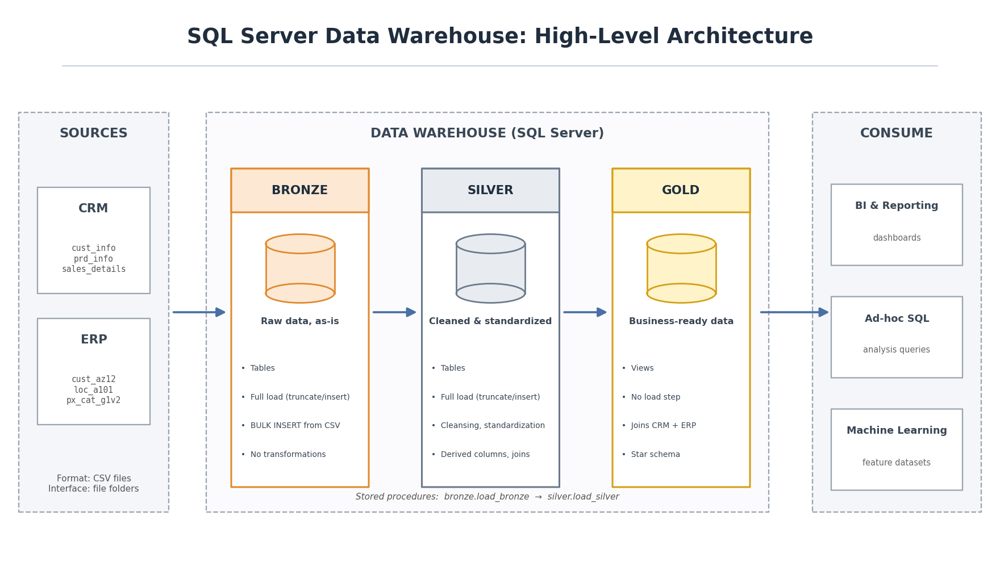

# SQL Data Warehouse (SQL Server, Medallion Architecture)

A guided learning project: a small data warehouse built in **SQL Server** with Bronze, Silver and Gold layers. It combines sales data from two source systems (CRM and ERP, both CSV files) into a star schema.

> **Credits:** I built this by following the free tutorial by **Data With Baraa** (Baraa Khatib Salkini), which is MIT licensed. The project idea, the dataset and the overall design come from that tutorial. I typed and ran the SQL myself, and I redrew the architecture diagram. The original copyright notice is kept in [LICENSE](LICENSE).

---

## Architecture



| Layer | What it does |
|-------|--------------|
| **Bronze** | Raw CSV data loaded as-is into SQL Server tables (`BULK INSERT`). |
| **Silver** | Cleaned data: trimmed text, standardised values, fixed dates, duplicates removed. |
| **Gold** | Business-ready **views** in a star schema: `dim_customers`, `dim_products`, `fact_sales`. |

## What is in this repository

```
sql-data-warehouse-project/
├── datasets/        # Placeholder only. The CSV files are NOT included (see "How to run")
├── docs/
│   ├── data_architecture.png   # Architecture diagram
│   ├── data_flow.png           # Data flow diagram
│   ├── data_integration.png    # How the source tables relate
│   ├── data_model.png          # Star schema
│   ├── data_catalog.md         # Description of the Gold tables and columns
│   └── naming_conventions.md   # Naming rules used in the SQL
├── scripts/
│   ├── init_database.sql       # Creates the DataWarehouse database and the 3 schemas
│   ├── bronze/                 # ddl_bronze.sql (tables) + proc_load_bronze.sql (load procedure)
│   ├── Silver/                 # ddl_silver.sql (tables) + proc_load_silver.sql (load procedure)
│   └── gold/ddl_gold.sql       # Creates the 3 Gold views
├── tests/
│   ├── quality_checks_silver.sql   # Data quality checks on Silver
│   └── quality_checks_gold.sql     # Data quality checks on Gold
├── LICENSE
└── README.md
```

## How to run

You need **SQL Server** and **SQL Server Management Studio (SSMS)** (both free: Developer/Express edition).

**1. Get the data.** The CSV files are not in this repo. Download the source files (`source_crm` and `source_erp` folders) from the original tutorial by Data With Baraa and place them in a folder on your computer.

**2. Fix the file paths.** In `scripts/bronze/proc_load_bronze.sql` every `BULK INSERT` uses a path like `C:\sql\dwh_project\datasets\source_crm\cust_info.csv`. Change `C:\sql\dwh_project\datasets` to the folder where you saved the data (6 places).

**3. Run the scripts in this order in SSMS:**

1. `scripts/init_database.sql`
2. `scripts/bronze/ddl_bronze.sql`
3. `scripts/bronze/proc_load_bronze.sql`
4. `scripts/Silver/ddl_silver.sql`
5. `scripts/Silver/proc_load_silver.sql`
6. `scripts/gold/ddl_gold.sql`

**4. Load the data:**

```sql
EXEC bronze.load_bronze;
EXEC silver.load_silver;
```

**5. Check the result:**

```sql
SELECT TOP 10 * FROM gold.fact_sales;
```

You can also run the files in `tests/` to see the quality checks.

> `init_database.sql` drops and recreates the `DataWarehouse` database. Do not run it on a server that has a database with that name you want to keep.

## What I learned

- Building a Bronze / Silver / Gold warehouse in plain SQL
- Cleaning data with SQL (duplicates, NULLs, inconsistent text, bad dates)
- Stored procedures and `BULK INSERT`
- Joining two source systems into a star schema (one fact table, two dimensions)
- Writing simple data quality checks

## Limitations (honest notes)

- Guided tutorial project, not an original design.
- The load is a full refresh every time (truncate and reload), not incremental.
- No automated tests or scheduling; the quality checks are SQL scripts run by hand.
- No dashboards or reports are included.

For a project that I designed and debugged myself, see my [airline-operations-lakehouse](https://github.com/fares-tech008/airline-operations-lakehouse) (Databricks, PySpark, Delta Lake, automated tests).

## License

MIT License. See [LICENSE](LICENSE). Original work © 2024 Baraa Khatib Salkini; modifications © 2026 Fares Bittar.

## About me

I'm **Fares Bittar**, an informatics student teaching myself data engineering (SQL, Python, Spark). This repository is one of my learning projects.
